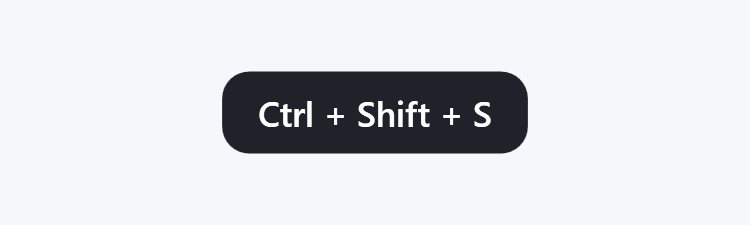
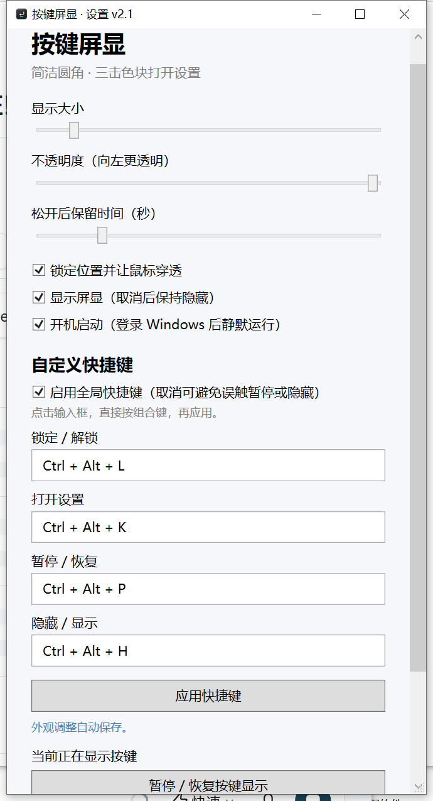

# KeyOverlay 按键屏显

Windows 桌面按键与鼠标操作屏显，适合录屏、演示和教学。支持外观设置、全局快捷键、暂停、隐藏及托盘恢复监听。

## 使用

解压 Windows 发布包，双击 `KeyOverlay.exe`。需要 Windows 和 .NET Framework 4.x WPF。

默认快捷键：Ctrl+Alt+L 锁定；Ctrl+Alt+K 设置；Ctrl+Alt+P 暂停；Ctrl+Alt+H 隐藏。设置中可关闭全局快捷键。托盘菜单可恢复按键显示与监听。

配置保存在 `%LOCALAPPDATA%/KeyOverlayRounded/settings.txt`。屏显会显示输入的按键；演示敏感信息前应暂停显示。

## 构建与测试

在项目根目录运行：

```powershell
powershell -ExecutionPolicy Bypass -File source/build.ps1
powershell -ExecutionPolicy Bypass -File source/test.ps1
```

源码、图标和回归测试位于 `source/`。发布包只包含程序、说明和第三方许可，不含本机配置或测试输出。

## 第三方许可

按键名称映射改编自 Brook Hong 的 KeyCastOW。完整 MIT 许可及上游版本信息见 [THIRD-PARTY.txt](THIRD-PARTY.txt)。

## 界面预览

程序在 Windows 上实际运行时的截图：按键屏显显示的是真实按键事件（Ctrl + Shift + S），设置窗口为真实界面；截图未包含桌面、任务栏或个人配置。



